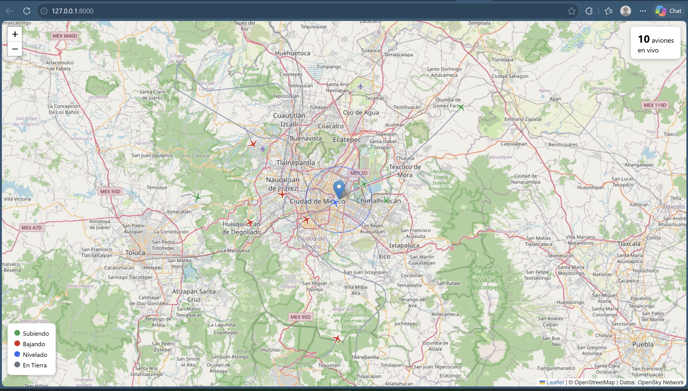

# Radar CDMX ✈️

Mapa en vivo de los aviones que vuelan sobre el Valle de México. Los datos se obtienen de la API pública de OpenSky Network, pasan por Apache Kafka y llegan al navegador por WebSockets, donde cada avión se dibuja y se mueve solo sobre un mapa de OpenStreetMap.



## Qué hace

- Consulta cada 15 segundos los aviones dentro de un recuadro que cubre la Ciudad de México y sus alrededores.
- Limpia los datos: quita espacios, convierte unidades y descarta aviones sin posición o sin contacto reciente.
- Publica cada lote en un tema de Kafka y lo reparte a todos los navegadores conectados, sin que tengan que recargar la página.
- Dibuja cada avión girado según su rumbo y con un color según lo que está haciendo:

| Color | Significado |
|---|---|
| Verde | Subiendo |
| Rojo | Bajando |
| Azul | Nivelado |
| Gris | En tierra |

- Marca el Aeropuerto Internacional de la Ciudad de México y un radio de 10 km a su alrededor.
- Muestra una ficha con vuelo, país, altitud, velocidad y rumbo al hacer clic en un avión.

## Arquitectura

```
OpenSky API ──► productor.py ──► Kafka (tema "aviones") ──► server.py ──► navegador
   (HTTP)        (recolector)        (Docker)             (WebSocket)    (Leaflet)
```

| Pieza | Archivo | Qué hace |
|---|---|---|
| Recolector | `collector.py` | Pide un token a OpenSky, consulta la API y limpia cada avión |
| Productor | `productor.py` | Llama al recolector cada 15 s y publica el lote en Kafka |
| Kafka | `docker-compose.yml` | Guarda los mensajes entre el productor y el servidor |
| Servidor | `server.py` | Lee de Kafka y reenvía cada lote por WebSocket |
| Mapa | `static/index.html` | Recibe los lotes y actualiza los aviones en el mapa |

El productor y el servidor no se conocen entre sí: solo comparten el tema de Kafka. Si el productor se detiene, el servidor y la página siguen funcionando con el último dato; cuando vuelve, el mapa retoma el movimiento sin recargar.

## Qué datos entrega la API

Se usa el endpoint `GET /states/all` de OpenSky con un recuadro de coordenadas (`lamin=19.0`, `lomin=-99.6`, `lamax=19.9`, `lomax=-98.6`). La respuesta trae la hora de la consulta y una lista `states` con un renglón por avión. Cada renglón es una lista sin nombres, así que los datos se leen por posición:

| Posición | Dato | Ejemplo |
|---|---|---|
| 0 | Identificador único del avión (ICAO24) | `0d12ac` |
| 1 | Vuelo, con espacios al final | `VIV1017 ` |
| 2 | País de registro | `Mexico` |
| 3 | Hora de la última posición (segundos Unix) | `1794509112` |
| 4 | Hora del último contacto (segundos Unix) | `1794509147` |
| 5 | Longitud | `-99.295` |
| 6 | Latitud | `19.7558` |
| 7 | Altitud barométrica en metros (`null` en tierra) | `4922.52` |
| 8 | ¿Está en tierra? | `false` |
| 9 | Velocidad en m/s | `137.4` |
| 10 | Rumbo en grados (0 = norte) | `178.5` |
| 11 | Velocidad vertical en m/s (negativa = bajando) | `-7.15` |
| 13 | Altitud geométrica en metros | `5173.98` |
| 14 | Código del transpondedor (squawk) | `1064` |

El recolector convierte cada renglón en un objeto con nombres claros, que es lo que viaja por Kafka y llega al mapa:

```json
{
  "id": "0d12ac",
  "vuelo": "VIV1017",
  "pais": "Mexico",
  "lon": -99.295,
  "lat": 19.7558,
  "altitud_m": 4922.52,
  "en_tierra": false,
  "velocidad_kmh": 495,
  "rumbo": 178.5,
  "vel_vertical": -7.15,
  "ultimo_contacto": 1794509147
}
```

## Requisitos

- Python 3.10 o superior
- Docker Desktop
- Una cuenta gratuita en [OpenSky Network](https://opensky-network.org) con un "API client" creado

## Cómo ejecutarlo

Los comandos son para Windows con PowerShell.

**1. Clona el repositorio y crea el entorno virtual**

```powershell
git clone https://github.com/Isacc-Cabrera/radar-cdmx.git
cd radar-cdmx
python -m venv .venv
.venv\Scripts\Activate.ps1
pip install -r requirements.txt
```

En macOS o Linux el entorno se activa con `source .venv/bin/activate`.

**2. Configura tus credenciales**

Crea un archivo `.env` en la carpeta del proyecto:

```
OPENSKY_CLIENT_ID=tu_client_id
OPENSKY_CLIENT_SECRET=tu_client_secret
```

Este archivo está en `.gitignore` y nunca debe subirse al repositorio. Sin él, el recolector funciona en modo anónimo, con un cupo diario mucho menor.

**3. Levanta Kafka**

```powershell
docker compose up -d
```

Espera unos 20 segundos a que termine de arrancar.

**4. Inicia el productor** (terminal 1)

```powershell
python productor.py
```

**5. Inicia el servidor** (terminal 2, con el entorno activado)

```powershell
uvicorn server:app --reload
```

**6. Abre el mapa**

Entra a <http://localhost:8000>.

## Configuración

| Parámetro | Dónde | Valor | Para qué sirve |
|---|---|---|---|
| `BBOX` | `collector.py` | 19.0 a 19.9 N, -99.6 a -98.6 O | Zona que se consulta |
| `INTERVALO` | `collector.py` | 15 s | Tiempo entre consultas a OpenSky |
| `MAX_ANTIGUEDAD` | `collector.py` | 60 s | Descarta aviones sin contacto reciente |
| `TEMA` | `productor.py`, `server.py` | `aviones` | Tema de Kafka |
| `SERVIDOR_KAFKA` | `productor.py`, `server.py` | `127.0.0.1:9092` | Dirección de Kafka |

Kafka corre en modo KRaft con un solo nodo y anuncia la dirección `127.0.0.1:9092` (`KAFKA_ADVERTISED_LISTENERS`). Se usa la dirección numérica en lugar de `localhost` porque en Windows el nombre `localhost` no siempre llega al contenedor y el cliente falla con `Unable to bootstrap from localhost:9092`.

## Limitaciones conocidas

- **Aviones congelados:** si el productor se detiene, el mapa sigue mostrando "en vivo" con la última posición de cada avión. Falta avisar cuánto tiempo lleva sin datos nuevos.
- **Cobertura:** los datos dependen de antenas de voluntarios, así que un avión puede desaparecer un momento aunque siga volando.
- **Cupo de la API:** OpenSky limita las consultas diarias, y por eso el intervalo es de 15 segundos y no menor.
- **Un mensaje por lote:** cada mensaje de Kafka lleva todos los aviones del momento. Con más volumen convendría un mensaje por avión, usando su identificador como clave.

## Mejoras futuras

- Mapa en 3D con la altitud real de cada avión.
- Aviso de "sin datos desde hace X segundos".
- Guardar el historial para analizar rutas y horarios de mayor tráfico.

## Tecnologías

Python, FastAPI, Uvicorn, Apache Kafka, Docker, Leaflet y OpenStreetMap.

## Créditos

- Datos de vuelos: [The OpenSky Network](https://opensky-network.org)
- Mapa base: © colaboradores de [OpenStreetMap](https://www.openstreetmap.org/copyright)

Proyecto desarrollado por Angel Isacc Cabrera Leal para la materia Ingeniería de Software y Laboratorio, IBERO Ciudad de México, Otoño 2026.
